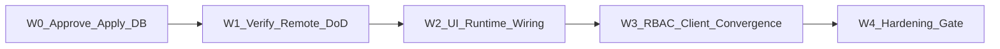

# Agnostic ERP Phase 1–4 클로즈아웃 계획

> **근거:** 2026-11-28 감사 (PARTIAL ~68/100, commit `ca1740f`)  
> **목표:** 로컬 구현 → **원격 DoD 충족** + 감사 MED 갭 해소  
> **헌법:** AGENTS.md — 원격 DB는 **승인 후** 적용. `check:all`은 최종 게이트.  
> **진행:** 2026-11-28 사용자 승인 후 W0–W3 적용 · 원격 스키마 스모크 통과.

---

## 1. 원칙

1. **원격 마이그레이션이 크리티컬 패스** — 앱 배선만으로는 Phase 1/3/4 DoD 불가.
2. **승인 전 앱 작업은 “원격 없이도 안전한 배선”만** — 시드 try/catch·코드 fallback 유지.
3. **새 Capability 금지** — 기존 service/UI 연결만.
4. **스테이징 먼저** — `book_schedule_slot` / `apply_stock_movement` / `has_permission` 재정의 포함.

---

## 2. 웨이브 개요



| Wave | 목적 | 승인 | 예상 공수 |
| :--- | :--- | :--- | :--- |
| **W0** | 원격 마이그레이션 적용 | **필수** | 운영/DB 0.5d + soak |
| **W1** | 원격 스키마·RPC·RLS 검증 | — | 0.5d |
| **W2** | MED UI/런타임 배선 4건 | — | 1–1.5d |
| **W3** | ACP↔aliases·scopeFailClosed | — | 0.5–1d |
| **W4** | 회귀·`check:all`·문서 체크리스트 | — | 0.5d |

---

## 3. Wave 0 — 원격 DB 적용 (HIGH · 블로커)

### 대상 (순서 고정)

1. `20261128200000_field_definitions_and_product_metadata.sql`
2. `20261128210000_phase3_allocation_tax_lifecycle_policies.sql`
3. `20261128220000_phase4_rbac_permission_unification.sql`

> `20261128190000_products_add_spec` 는 원격에 이미 반영된 것으로 감사됨. 중복 적용 주의.

### 사전 체크

- [ ] 스테이징 백업 / branch 스냅샷
- [ ] 레거시 역할 JSONB에 `billing_invoices` 등 존재 → Phase4 alias가 커버하는지 확인
- [ ] 스태프가 `finance.read`/`sales.*` 없이 결제·판매 화면 쓰는지 샘플 테넌트 점검 (RESTRICTIVE RLS 잠금 예방)

### 적용 후 즉시 스모크 (SQL)

```sql
SELECT to_regclass('core.field_definitions');
SELECT to_regclass('core.allocation_policies');
SELECT to_regclass('core.permission_key_aliases');
SELECT to_regclass('core.sensitive_field_policies');
-- product_categories.parent_id 존재
SELECT core.member_has_permission('<org>'::uuid, 'finance.read');
```

**게이트:** 위 객체 NULL 아님 + 스태프/오너 각 1계정으로 payments·sales·products 쓰기 스모크.

---

## 4. Wave 1 — 원격 DoD 검증

| Phase | 검증 | 기준 |
| :--- | :--- | :--- |
| P1 | org A에만 필드 추가 → org B 비가시 | PHASE1_SPEC §5 RLS |
| P1 | `seed_field_definitions_from_preset` 온보딩 | Wizard 신규 org |
| P3 | overbook waitlist / negative_stock warn | 설정 UI 변경 후 RPC |
| P3 | POS 세액 표시 + tax_policies row | SalePosView |
| P4 | alias: `billing_invoices` → finance 경로 | 매트릭스만 켠 스태프 |
| P4 | `scope_fail_closed=true` 시 미배정 지점 거부 | SQL `has_permission` |

**산출:** 체크리스트를 각 PHASE*_SPEC DoD 항목에 `[x]` 반영 (원격 검증 후).

---

## 5. Wave 2 — UI / 런타임 배선 (MED)

승인 없이도 코드 가능하나, **W0 이후**에 통합 테스트하는 것이 안전.

| # | 작업 | 파일 (예상) | 완료 조건 |
| :--- | :--- | :--- | :--- |
| 2.1 | 상품 커스텀필드 패리티 | `ProductFormModal.tsx` ← `resolveCustomFieldDefinitions('product')` + metadata | Settings에서 정의한 product 필드가 폼에 나타나고 저장됨 |
| 2.2 | 안전재고 알림 정책 주입 | `RetailHomeView` / `ProductListView` ← `resolveAllocationPolicy().enableSafetyStockAlert` | 토글 OFF 시 저재고 배너/필터 억제 |
| 2.3 | 예약 lifecycle side-effect | confirm/cancel notify 경로 ← `isBookingSideEffectEnabled` | 설정 OFF 시 알림 사이드이펙트 스킵 (또는 SPEC에 settings-only 명시) |
| 2.4 | PII 마스킹 최소 배선 | 고객/명부 상세 1면 ← `getCustomerMasked` | write 권한 없는 스태프에 phone/email 마스킹 |

**비범위:** `pricing_plans` / mid-term `platform.industry_presets` / staffGrants 전량 제거.

---

## 6. Wave 3 — RBAC 클라이언트 수렴

| # | 작업 | 완료 조건 |
| :--- | :--- | :--- |
| 3.1 | `accessControlProvider`가 `permissionAliases`를 SSOT로 사용 (하드코드 `billing_invoices` 분기 축소) | alias 테스트 + ACP 테스트 녹색 |
| 3.2 | org `settings.rbac.scope_fail_closed`를 `createAuthorizationApi` / ACP → `evaluatePermission({ scopeFailClosed })` 전달 | UI 토글 ON 시 Refine can과 SQL 판정 일치 |
| 3.3 | (선택) payments WITH CHECK의 `finance.read` 쓰기 허용 재검토 | 스펙/보안 메모 문서화 또는 수정 |

---

## 7. Wave 4 — 하드닝 게이트

- [ ] `npm run check:all` 100%
- [ ] 스테이징에서 오너/매니저/스태프 3역할 스모크 (명부·POS·재고·직급 grants)
- [ ] 로드맵 §9 체크리스트 Phase 1–4 → “원격 적용 완료”
- [ ] `staffGrants` 폐기는 일정 유지 (2026-Q3) — 본 클로즈아웃 비범위

---

## 8. 의사결정 (확정안)

| 주제 | 결정 | 근거 |
| :--- | :--- | :--- |
| 스코프 기본값 | **옵트인 fail-closed 유지** | 기존 테넌트 잠금 방지; W3에서 UI↔SQL 동기화 |
| 필드 ACL | **RPC 옵트인 + 1면 배선** | 컬럼 RLS 전면 도입은 후속 |
| lifecycle 미연결 시 | **W2.3에서 연결 우선**, 불가 시 SPEC에 stub 명시 | 설정 UI만 있는 상태 금지 |
| 원격 적용 창 | **스테이징 승인 → soak → 운영** | AGENTS.md DB 안전 |

---

## 9. 착수 조건

**지금 바로 가능한 것:** Wave 2.1–2.4 앱 배선 (원격 없이도 컴파일·단위테스트 가능).  
**블로커:** Wave 0 — 사용자/운영의 **원격 마이그레이션 승인** 한 줄.

승인 문구 예:  
> “스테이징에 `20261128200000`~`20261128220000` 적용 승인”

---

## 10. 참고

- 감사 캔버스: IDE `agnostic-erp-phase1-4-audit.canvas.tsx`
- [ROADMAP](./MOA_AGNOSTIC_ERP_ROADMAP.md) · [P1](./MOA_AGNOSTIC_ERP_PHASE1_SPEC.md) · [P2](./MOA_AGNOSTIC_ERP_PHASE2_SPEC.md) · [P3](./MOA_AGNOSTIC_ERP_PHASE3_SPEC.md) · [P4](./MOA_AGNOSTIC_ERP_PHASE4_SPEC.md)
