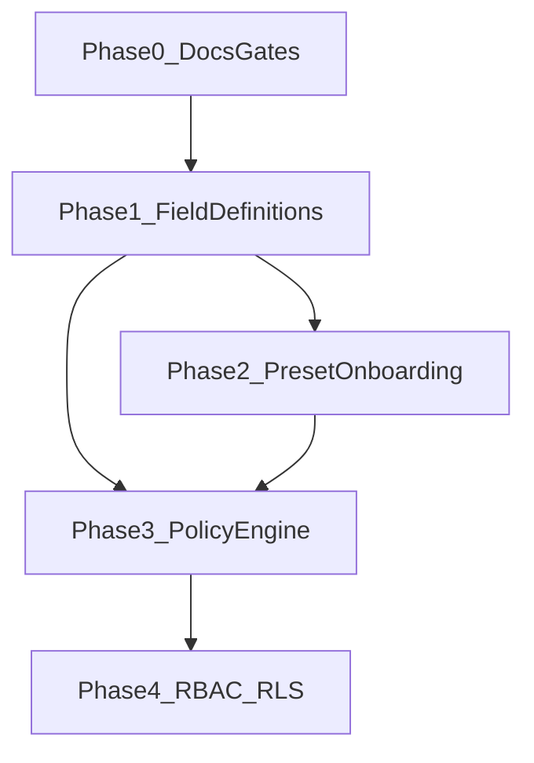

# Moa-v2 범용 ERP 설정·규칙 엔진 로드맵

> **문서 버전:** 1.0.0  
> **작성 기준:** 2026-11 범용성 감사  
> **헌법:** [docs/rules/7_AGNOSTIC_CONFIGURATION.md](./rules/7_AGNOSTIC_CONFIGURATION.md)  
> **Phase 1 상세 스펙:** [docs/MOA_AGNOSTIC_ERP_PHASE1_SPEC.md](./MOA_AGNOSTIC_ERP_PHASE1_SPEC.md)  
> **Phase 2 상세 스펙:** [docs/MOA_AGNOSTIC_ERP_PHASE2_SPEC.md](./MOA_AGNOSTIC_ERP_PHASE2_SPEC.md)  
> **Phase 3 상세 스펙:** [docs/MOA_AGNOSTIC_ERP_PHASE3_SPEC.md](./MOA_AGNOSTIC_ERP_PHASE3_SPEC.md)  
> **Phase 4 상세 스펙:** [docs/MOA_AGNOSTIC_ERP_PHASE4_SPEC.md](./MOA_AGNOSTIC_ERP_PHASE4_SPEC.md)  
> **클로즈아웃 계획:** [docs/MOA_AGNOSTIC_ERP_CLOSEOUT_PLAN.md](./MOA_AGNOSTIC_ERP_CLOSEOUT_PLAN.md)

---

## 1. 목표

| 질문 | 목표 답 |
| :--- | :--- |
| 새 업종을 코드 배포 없이 켤 수 있는가? | 기존 Capability 조합만 필요하면 **가능** (프리셋+온보딩+설정) |
| 언제 코드/마이그레이션이 필요한가? | 신규 Capability, 신규 물리 불변성, 신규 외부 어댑터 |

우선순위(합의): **① 필드 메타데이터 → ② 프리셋/온보딩 → ③ 정책 엔진 → ④ RBAC/RLS**



---

## 2. 현재 기준선 (감사 요약)

| # | 영역 | 수준 | 한 줄 |
| :--- | :--- | :--- | :--- |
| 1 | 도메인·메타데이터 | 일부 종속 | `core.*` 범용, 필드 정의는 코드 프리셋, `piano`/`bath`/`care_*` 특화 잔존 |
| 2 | 온보딩 | 일부 종속 | TS 프리셋 ~53, QuickSetup 시드 vs Wizard 빈약 |
| 3 | 상태·워크플로 | 일부 종속 | ENUM+코드 전이, 승인 템플릿만 테넌트 |
| 4 | 과금·정산 | 일부 종속 | `monthly`\|`session_pass`, 세금/절사 정책 테이블 없음 |
| 5 | 자원·수량 | 일부 종속 | DB 강제 강함, allow/warn/forbid 스위치 없음 |
| 6 | 테넌트·RBAC | 격리 강 / RBAC 부분 | RLS org 격리 OK, 매트릭스↔RLS 불일치 |

**차단 근거 파일 (대표)**

- 필드 프리셋: [`src/core/customer/customFields.ts`](../src/core/customer/customFields.ts) `INDUSTRY_CUSTOM_FIELDS`
- 엔진(메모리 레지스트리): [`src/core/fields/dynamicFieldEngine.ts`](../src/core/fields/dynamicFieldEngine.ts)
- 프리셋 레지스트리: [`src/app/presets/presetRegistry.ts`](../src/app/presets/presetRegistry.ts)
- 설정 타입: [`src/core/organizations/settingsTypes.ts`](../src/core/organizations/settingsTypes.ts)
- 예약 전이: [`src/core/schedules/bookingStatusTransition.ts`](../src/core/schedules/bookingStatusTransition.ts)
- 재고 비음수: `apply_stock_movement` + `inventory_quantity_nonneg_chk`

---

## 3. Phase 0 — 헌법·게이트 (완료 조건: 본 문서 + rules/7)

- [x] [`docs/rules/7_AGNOSTIC_CONFIGURATION.md`](./rules/7_AGNOSTIC_CONFIGURATION.md)
- [x] 본 로드맵
- [x] Phase 1 구현 스펙 분리 ([PHASE1_SPEC](./MOA_AGNOSTIC_ERP_PHASE1_SPEC.md))
- [x] AGENTS.md 색인

**게이트:** 문서만. 애플리케이션/DB 변경 없음.

---

## 4. Phase 1 — 테넌트 `field_definitions` (최우선)

### 4.1 목적

테넌트가 **설정 UI만으로** 엔티티 필드(label / required / type / options)를 정의하고, 명부·폼이 이를 렌더한다. 코드에 업종 필드를 추가하지 않는다.

### 4.2 스키마 (설계)

```text
core.field_definitions
  id uuid PK
  organization_id uuid NOT NULL REFERENCES core.organizations ON DELETE CASCADE
  entity_type text NOT NULL  -- customer|student|product|resource|…
  key text NOT NULL
  label text NOT NULL
  data_type text NOT NULL    -- text|number|select|boolean|date|textarea|json
  required boolean NOT NULL DEFAULT false
  placeholder text
  description text
  options jsonb              -- select options
  default_value jsonb
  sort_order int NOT NULL DEFAULT 0
  is_active boolean NOT NULL DEFAULT true
  deleted_at timestamptz
  created_at / updated_at
  UNIQUE (organization_id, entity_type, key) WHERE deleted_at IS NULL
  RLS: org members SELECT; admin/owner (또는 fields:manage) CUD
```

값 저장: 기존 `customers.metadata` UMS (`metadata.custom_fields`) 유지.  
부가: `core.products.metadata jsonb`, `core.product_categories.parent_id uuid NULL`.

### 4.3 코드 연동

| 현재 | 전환 |
| :--- | :--- |
| `INDUSTRY_CUSTOM_FIELDS` | org 생성/프리셋 적용 시 **시드 소스** → `field_definitions` INSERT |
| `getCustomFieldsForIndustry` | `listFieldDefinitions(orgId, entityType)` DB 조회 + 캐시 |
| `rosterSchemaConfig` | DB 정의 병합 |
| `AutoSchemaForm` | 엔티티 필드 편집기 재사용 또는 전용 Settings 화면 |

### 4.4 설정 UI

- 경로 후보: 사업장 설정 → 「커스텀 필드」 (`WorkplaceSettings` / SettingsHub)
- CRUD + 미리보기, entity_type 탭 (1차: customer/student)

### 4.5 게이트

1. 설정만으로 필드 추가 → 원생/고객 폼에 표시·저장  
2. 업종 코드 수정 없이 동작  
3. piano / pilates 기존 프리셋 필드가 시드로 동등 재현  
4. `npm run check:all`  
5. **마이그레이션 승인 후** 적용 ([PHASE1_SPEC](./MOA_AGNOSTIC_ERP_PHASE1_SPEC.md))

### 4.6 비범위 (Phase 1)

- `piano.customers` 컬럼 드롭, `care_*` 이관  
- 제품 카탈로그 전체 스키마 재설계 (metadata·parent_id만)

---

## 5. Phase 2 — 프리셋·온보딩 데이터화

> 상세: [MOA_AGNOSTIC_ERP_PHASE2_SPEC.md](./MOA_AGNOSTIC_ERP_PHASE2_SPEC.md) · **단기 완료**

### 5.1 목적

프리셋이 컴파일타임 TS만이 아니라 **버전드 데이터**로 주입 가능. Wizard와 QuickSetup 시드 패리티.

### 5.2 설계

**단기 (완료):** `src/app/presets/data/*.json` + `presetDataLoader` / `organizationPresetSeed`.  
**중기:** `platform.industry_presets` / `platform.capability_bundle_refs` 테이블 + 관리자 동기화.

시드 페이로드(QuickSetup과 동일):

- roles, rooms, lockers, operating_hours  
- capabilities, terms, businessRules  
- **신규:** 기본 `field_definitions` 템플릿, 기본 분류/단위, 기본 allocation/tax 정책 스텁

### 5.3 코드

| 파일 | 변경 |
| :--- | :--- |
| [`CreateOrganizationWizard`](../src/core/organizations/CreateOrganizationWizard.tsx) | `create_organization_with_preset` 또는 동등 시드 호출 |
| [`QuickSetupPage`](../src/pages/onboarding/QuickSetupPage.tsx) | 패리티 유지, 필드/분류 시드 추가 |
| [`AcademyOpenQuestWidget`](../src/core/onboarding/AcademyOpenQuestWidget.tsx) | [`questEngine`](../src/app/onboarding/questEngine.ts) 경로로 흡수 |
| [`presetRegistry.ts`](../src/app/presets/presetRegistry.ts) | JSON/DB 로더 어댑터 |

### 5.4 게이트

- 기존 Capability만 쓰는 수직: 프리셋 데이터 행(+카탈로그 id)으로 온보딩  
- 전용 모듈 업종(`piano`, `retail`, …)은 **예외 목록**으로 문서화  
- Wizard 재실행 멱등 ([6_PRESET_LIFECYCLE](./rules/6_PRESET_LIFECYCLE.md))

---

## 6. Phase 3 — 정책 엔진

하위 순서 고정: **3a 할당 → 3b 과금 → 3c 상태**

### 6.1 Phase 3a — 할당·재고·예약

```text
core.allocation_policies (
  organization_id PK,
  overbook_mode text CHECK IN ('forbid','warn','allow'),
  negative_stock_mode text CHECK IN ('forbid','warn','allow'),
  hold_ttl_seconds int,
  ...
)
```

- `book_schedule_slot` / `apply_stock_movement`가 정책 읽음  
- setupSchema `allowWaitlist`, `enableSafetyStockAlert` 등 **실연결**  
- 예약 write path 단일화 (`saveBooking` vs RPC)  
- `booking_seat_locks`: 활성화(TTL soft-hold) 또는 마이그레이션으로 폐기 결정

**게이트:** 테넌트가 초과예약/마이너스재고 모드를 바꾸고 동작이 달라짐.

### 6.2 Phase 3b — 과금·세금·환불

```text
core.pricing_plans / price_components (qty|time|session|subscription|composite)
core.tax_policies (inclusive|exclusive, rate, exempt codes)
core.rounding_policies (floor|round|ceil, unit)
core.refund_penalty_schedules (tiers)
```

- `StudentBillingMode` → 플랜 구독으로 일반화 (하위 호환 매핑 유지)  
- [`settingsTypes.ts`](../src/core/organizations/settingsTypes.ts) education 파티션과 병행 후 이전

**게이트:** 세금·절사 설정이 수납/판매 금액에 반영.

### 6.3 Phase 3c — 상태 전이

```text
core.lifecycle_definitions (domain, status catalog)
core.lifecycle_transitions (from, to, guards)
core.lifecycle_side_effects (notify|deduct|approve …) 토글
```

- FSM 프리미티브 재사용: [`stateMachine.ts`](../src/core/domain/stateMachine.ts)  
- 1차 도메인: 예약 **또는** 출결 중 하나  
- DB ENUM과 병행 카탈로그 → 점진 이전

**게이트:** 최소 1개 도메인에서 전이/부수효과를 설정으로 토글.

---

## 7. Phase 4 — RBAC → RLS 단일화

> 상세: [MOA_AGNOSTIC_ERP_PHASE4_SPEC.md](./MOA_AGNOSTIC_ERP_PHASE4_SPEC.md)  
> 앱/마이그레이션 완료 · **원격 DB 적용은 별도 승인**

### 7.1 목적

커스텀 역할 매트릭스가 **메뉴 + 데이터 범위 + 민감 필드**를 실제로 통제.

### 7.2 작업

1. ~~주요 테이블 RLS를 `has_permission` / `member_has_permission` 경로로 수렴~~ (payments/sales/products 파일럿)  
2. ~~권한 키 네임스페이스 통일~~ (`permission_key_aliases`)  
3. ~~`authorization_grants` 할당 UI~~; 미할당 fail-open은 **옵트인** `settings.rbac.scope_fail_closed`  
4. ~~민감 컬럼 마스킹 RPC~~ (`get_customer_masked` + `sensitive_field_policies`)  
5. ~~`staffGrants` / `feature_permissions` 폐기일 명시~~ (2026-Q3, PHASE4_SPEC)

기준 코드: [`DynamicRoleSettingsPage`](../src/pages/settings/DynamicRoleSettingsPage.tsx), `organization_roles`, `permission_catalog`

### 7.3 게이트

- [x] 커스텀 역할 + grants로 메뉴·담당 범위 제어 경로  
- [x] 필드 ACL 최소 구현  
- [x] 병렬 스택 폐기 일정 문서화  
- [x] 원격 DB 마이그레이션 승인·적용

---

## 8. 비범위

- `piano`/`bath` 스키마 **즉시 삭제** (Phase 1 이후 점진 이전)  
- 신규 Capability 대량 추가  
- Storybook 태블릿 뷰포트 전수 (별도 UX 트랙; 태블릿 표준은 [`3_COMMERCIAL_UX`](./rules/3_COMMERCIAL_UX.md) §5)

---

## 9. 실행 체크리스트

| 순서 | 액션 | 상태 |
| :--- | :--- | :--- |
| 0 | 헌법·로드맵·AGENTS 색인 | 본 PR/커밋 |
| 1 | Phase 1 마이그레이션 **승인** 후 SPEC 구현 | 앱+원격 적용 완료 ([PHASE1_SPEC](./MOA_AGNOSTIC_ERP_PHASE1_SPEC.md)) |
| 2 | Phase 2 프리셋 데이터화 | 단기 JSON 로더·Wizard 패리티 완료 ([PHASE2_SPEC](./MOA_AGNOSTIC_ERP_PHASE2_SPEC.md)) |
| 3 | Phase 3a→3b→3c | 앱+원격 적용 완료 ([PHASE3_SPEC](./MOA_AGNOSTIC_ERP_PHASE3_SPEC.md)) |
| 4 | Phase 4 RBAC | 앱+원격 적용 완료 · 클로즈아웃 배선 ([PHASE4_SPEC](./MOA_AGNOSTIC_ERP_PHASE4_SPEC.md) · [CLOSEOUT](./MOA_AGNOSTIC_ERP_CLOSEOUT_PLAN.md)) |

---

## 10. 참고 문서

- [AGENTS.md](../AGENTS.md)  
- [7_AGNOSTIC_CONFIGURATION.md](./rules/7_AGNOSTIC_CONFIGURATION.md)  
- [6_PRESET_LIFECYCLE.md](./rules/6_PRESET_LIFECYCLE.md)  
- [2_DATA_AND_SECURITY.md](./rules/2_DATA_AND_SECURITY.md)  
- [MOA_AGNOSTIC_ERP_PHASE1_SPEC.md](./MOA_AGNOSTIC_ERP_PHASE1_SPEC.md)  
- [MOA_AGNOSTIC_ERP_PHASE2_SPEC.md](./MOA_AGNOSTIC_ERP_PHASE2_SPEC.md)  
- [MOA_AGNOSTIC_ERP_PHASE3_SPEC.md](./MOA_AGNOSTIC_ERP_PHASE3_SPEC.md)  
- [MOA_AGNOSTIC_ERP_PHASE4_SPEC.md](./MOA_AGNOSTIC_ERP_PHASE4_SPEC.md)  

